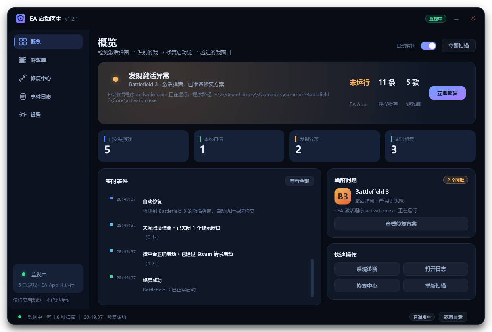
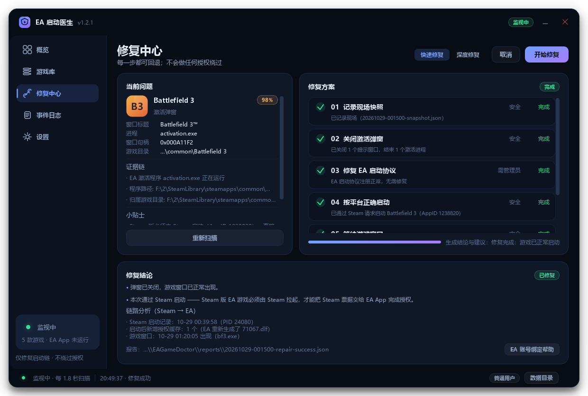
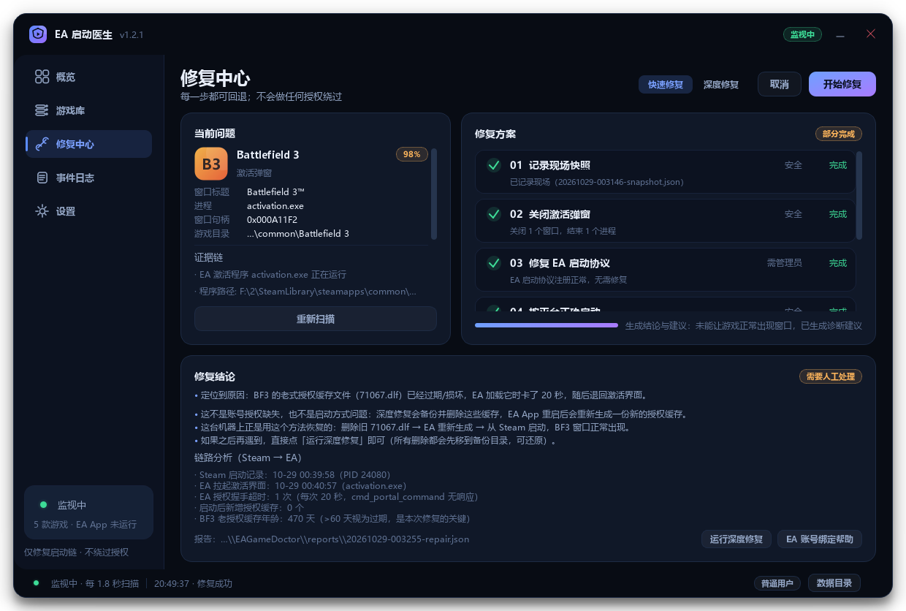
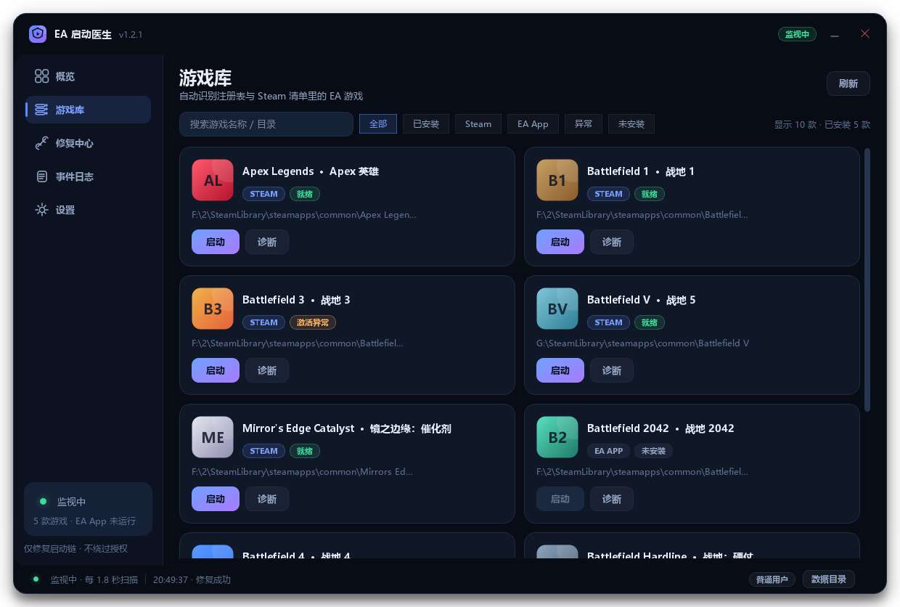

# EA 启动医生 · EA Game Doctor

> 检测 EA App / Origin 的「Could Not Activate（无法激活）」弹窗，识别是哪一款游戏，按正确链路修好启动流程，并验证游戏窗口真的出现。
>
> 界面：PySide6 自绘深色主题 · 概览 / 游戏库 / 修复中心 / 事件日志 / 设置



**English** · An unofficial Windows utility that detects EA App / Origin "Could Not Activate" dialogs, identifies the affected game, repairs the launch chain (URL protocol registration, stale license caches, correct Steam/EA launch path, EA client restart) and verifies that the game window actually appears. Every destructive step is backup-and-move, and it never bypasses licensing. Built with PySide6; 37 automated tests.

---

## 它解决什么问题

EA 游戏（尤其是 Steam 版）启动时，经常不是进游戏，而是弹出这样一窗：

```
Battlefield 3™
Could Not Activate
We could not activate Battlefield 3 on this computer using the Origin
Account you provided. Please locate your product key ...
```

这就是 EA Core 拉起了游戏目录里的 `Core\activation.exe` 激活界面。常见原因有四类：

1. **启动链错了**：Steam 版游戏被直接双击 `exe`、或用第三方整合启动器拉起，EA App 收不到 Steam 票据 → 只能走激活流程；
2. **EA 客户端状态异常**：后台服务没起来、URL 协议注册损坏、EA App 没登录；
3. **授权缓存损坏 / 过期**：`.dlf` 缓存坏了，EA 反复重新申请授权；
4. **账号确实没有该游戏的授权**：这种只能走官方渠道核对账号，本工具不会也无法"变"出授权。

本工具做的是 **1~3**：正确识别、正确启动、必要时刷新缓存，并诚实报告第 4 类情况。

---

## 功能

| 功能 | 说明 |
|---|---|
| 实时监视 | 每 1~5 秒扫描一次窗口，检测到激活弹窗 / 被拦截的游戏启动会立即在界面与托盘提示 |
| 游戏识别 | 从 `activation.exe` 的进程路径、窗口标题、EA 注册表、Steam 清单（多库）综合判定是哪款游戏 |
| 一键修复（快速） | 关闭激活弹窗 → 修复启动协议 → **按平台正确启动**（Steam 版走 Steam，其它走主程序）→ 等待并验证游戏窗口 |
| 深度修复 | 额外：结束残留游戏进程 → 优雅关闭 EA App → 备份并刷新授权缓存 → 重启 EA App → 启动并验证 |
| 可回退 | 所有清理都是"移动到备份目录"，支持一键还原 |
| 运行状态识别 | 游戏启动后，游戏库对应卡片显示「运行中」；支持 exe 名 / 窗口标题兜底识别，权限受限时也能认出来 |
| 启动链路分析 | 读 Steam `gameprocess_log` + EA Core 日志，判断「Steam 到底有没有拉起游戏」「EA 授权握手是否 20 秒超时」「启动后有没有下发新授权」「BF3 老授权缓存是否过期」 |
| 日志兜底检测 | 即使进程/窗口枚举受限（沙箱、权限异常），也能从 EA Core 日志里的 `activation.exe` 启动记录发现激活弹窗 |
| 系统诊断 | EA App / 登录状态 / 账号绑定 / 后台服务 / 协议注册 / 授权缓存 / Steam / 游戏完整性 / 残留目录，逐项给出结论与修复建议 |
| 事件日志 | 全量时间线，可筛选、搜索、导出 |
| 启动游戏 | 游戏库里直接按正确方式启动（Steam AppID 或主程序），并自动回查是否被弹窗拦截 |

---

## 快速开始

1. 双击 **`启动 EA 启动医生.bat`**；
2. 首次运行会自动创建 `.venv` 并安装依赖（`PySide6-Essentials`、`psutil`）。仓库不包含 `.venv` / `.wheels` 等大体积二进制；如需离线安装，把依赖轮子放进项目根的 `.wheels` 目录即可（脚本会优先离线安装）；
3. 打开游戏 → 如果弹出「无法激活」，工具会自动识别并提示；也可以点「立即修复」或进「修复中心」手动执行；
4. 想先看诊断结论：概览 → 快速操作 →「系统诊断」。

环境要求：Windows 10/11 64 位，Python 3.10+（首次准备时需要；之后都由 `.venv` 运行）。
不需要管理员权限即可完成大部分修复；「修复 EA 启动协议」「重启 EA 后台服务」需要管理员（设置页可一键提权重启）。

---

## 界面导览

| 页面 | 内容 |
|---|---|
| **概览** | 守护状态、EA App / 授权缓存 / 游戏库状态、实时事件流、当前问题、快速操作 |
| **游戏库** | 自动发现注册表与 Steam 清单里的 EA 游戏；显示平台、状态、安装目录、第三方启动器警告；可启动 / 诊断 / 修复 |
| **修复中心** | 左：当前问题 + 证据链 + 小贴士；右：可回退的步骤清单 + 进度；底部：修复结论与报告 |
| **事件日志** | 检测 / 修复 / 启动的完整时间线，支持级别筛选、搜索、导出 |
| **设置** | 监视间隔、自动修复策略、验证时长、启动偏好、通知、备份、权限、关于 |





---

## 修复链是怎么设计的

### 快速修复（默认，安全）

| 步骤 | 风险 | 做什么 |
|---|---|---|
| 01 记录现场快照 | 安全 | 窗口、进程、授权缓存、EA Core 日志证据，落盘 JSON 报告 |
| 02 关闭激活弹窗 | 安全 | 向弹窗发 `WM_CLOSE`；关不掉时结束 `activation.exe` |
| 03 修复 EA 启动协议 | 需管理员 | 校验并修复 `origin` / `origin2` / `link2ea` 注册；无权限时跳过并提示 |
| 04 按平台正确启动 | 安全 | Steam 版 → `steam://rungameid/<AppID>`；其它 → 主程序（确保 EA App 在运行） |
| 05 等待游戏窗口 | 安全 | 轮询窗口；**弹窗再次出现会立即判定失败并解释原因** |
| 06 生成结论与建议 | 安全 | 汇总证据；失败时给出账号 / 启动方式 / 修复安装的具体建议 |

### 深度修复（需要时再选）

额外包括：结束残留游戏进程（无窗口且已卡住 > 20s）→ 优雅关闭 EA App → **备份** `C:\ProgramData\Electronic Arts\EA Services\License\*.dlf` 后移走（EA App 重启会重新拉取）→ 重启 EA App → 启动验证。
清理前会要求确认，清理后可一键还原。

**自动修复**默认只执行「快速修复」，且只对置信度 ≥ 85% 的问题生效；游戏自己的窗口已经在运行时不会自动重启它。

---

## 已确认的修复案例：BF3 老授权缓存过期（71067.dlf）

这台机器上的真实过程（2026-10-29 凌晨）：

1. Steam 正常拉起 BF3（`EASteamLauncher` / `bf3.exe` / `EACoreServer` 全部启动）；
2. EA Core 日志里每次都出现 `cmd_portal_command ... timed out: 20000 ms`，然后拉起 `activation.exe` → 弹出「Could Not Activate」；
3. 授权缓存目录里 `71067.dlf`（BF3 的老式授权文件）停留在 **2025-07-15**，启动后也没有生成新的授权文件；
4. 备份并删除这个旧文件 → 重启 EA App（它会重新生成 `71067.dlf`，新文件时间 01:16:58）→ 从 Steam 启动；
5. **BF3 游戏窗口在 01:20 正常出现，Battlelog 也正常打开，不再弹激活窗。**

所以「EA 授权握手 20 秒超时 + 没有新授权」并不一定是账号没授权，**BF3 这种老游戏的授权缓存文件过期/损坏**同样会触发。工具现在的处理：

- **深度修复**会备份并删除过期的 BF3 授权缓存（`71067.dlf` / `70619.dlf` / `70169.dlf`）、清理老下载缓存、重启 EA App，再从 Steam 启动；
- 链路分析会直接显示「BF3 老授权缓存年龄：N 天（>60 天视为过期）」；
- 快速修复失败且判定为这类原因时，会弹窗询问是否立刻执行深度修复；
- 所有删除都是移动到备份目录，可在「还原备份」里放回去。

> 该思路与社区工具 [BF3 License Fixer](https://github.com/voidfnc/bf3_license_fixer) 的公开说明一致：清理 BF3 授权缓存并重启 EA 客户端。

## 为什么还会提示「需要人工处理」

工具的目标是**把「启动方式问题」和「账号授权问题」分开**，而不是对所有问题都硬修一遍。修复中心底部会显示一条链路分析，例如：

```
链路分析（Steam → EA）
· Steam 启动记录：10-29 00:39:58（PID 11724）
· EA 拉起激活界面：10-29 00:40:57（activation.exe）
· EA 授权握手超时：1 次（每次 20 秒，cmd_portal_command 无响应）
· 启动后新增授权缓存：0 个
· EA App 运行模式：silent
```

这组特征的含义是：

- **Steam 侧没问题**：Steam 确实把游戏拉起来了，`EASteamLauncher` 也带上了 `offerId=DR:224766400`（BF3）；
- **EA 侧没完成授权**：`cmd_portal_command` 20 秒超时；
- **没有下发新授权**：启动后授权缓存 `.dlf` 没有新增，说明 EA 服务端没有给这个账号发这款游戏的授权。

结论：**是 EA 账号侧的授权问题**（当前 EA 账号没有这款游戏，或授权绑定在另一个 EA 账号上），不是启动方式/缓存问题。工具不会（也不应该）绕过这个检查。处理顺序：

1. 在 EA App 左下角确认登录的 EA 账号（工具的「EA 账号绑定信息」会直接解出 EA 账号 ↔ Steam 账号的绑定关系）；
2. 如果这款游戏以前用另一个 EA/Origin 账号激活过，退出登录换那个账号；
3. 在 Steam「库 → 右键游戏 → 管理 → 账户明细」确认是自己购买、不是家庭共享；
4. 确认自购仍失败：带 Steam 购买凭证联系 EA 客服重新落授权；
5. 想先排除客户端状态，可以再点「运行深度修复」（完整界面重启 EA App + 备份刷新授权缓存）。

> `tools/chain_report.py` 可以在命令行直接打印这条链路分析，反馈问题时很方便。


1. **进程优先**：`activation.exe` 从某个游戏的安装目录（尤其是 `Core\`）启动，几乎可以 100% 判定为 EA 的激活界面，游戏直接由目录归属确定；
2. **EA 窗口评分**：EA 客户端进程 + 窗口标题含游戏名 / "Could Not Activate" / "无法激活" 等关键字 + 窗口尺寸像对话框（非最大化、面积 < 60% 屏幕）→ 加权判定，并输出证据链；
3. **游戏目录映射**：按进程 exe 路径反查所属游戏（最长目录前缀匹配），比标题匹配更可靠；
4. **EA Core 日志佐证**：解析 `C:\ProgramData\Electronic Arts\EA Core\logs\*.log` 里的 `CreateProcessW(...activation.exe...)` 记录，确认"EA 确实走了激活分支"；
5. **健康信号**：游戏自己的窗口存在 → 判定正常，不做任何操作。

判断结果在界面里以「证据链 + 置信度」展示，不黑箱。

---

## 数据、备份与日志

- 默认目录：`%LOCALAPPDATA%\EAGameDoctor\`
- 如果该目录不可写（受限环境），自动退回 **程序目录下的 `data\`**
- `config.json` 设置 · `logs\app.log` 文本日志 · `reports\*.json` 现场快照与修复报告 · `backups\<时间戳>\` 可还原的备份（含 `manifest.json`）
- 可用环境变量 `EAGAMEDOCTOR_HOME` 指定数据目录

---

## 命令行

```bash
# 只做一次检测，输出 JSON（游戏列表 + 检测到的问题 + 证据）
.venv\Scripts\python.exe main.py --scan

# 系统诊断
.venv\Scripts\python.exe main.py --diagnose

# 查看修复方案（quick / deep）
.venv\Scripts\python.exe main.py --plan deep

# 界面预览渲染（开发用，输出 PNG）
.venv\Scripts\python.exe main.py --preview preview_out
```

---

## 测试

```bash
.venv\Scripts\python.exe tests\run_all.py
```

共 **37 项**：目录匹配 / 检测评分（10 例）/ 真实机器游戏发现 / 备份还原 / dry-run 修复全流程 / 启动链路分析（Steam 日志 + EA Core 日志 + 授权缓存）/ EA token 解析 / **真实 Tk 窗口的枚举-判定-WM_CLOSE 集成链路**。

---

## 目录结构

```
ea-game-doctor/
├─ main.py                    # 入口（GUI / CLI / 预览）
├─ 启动 EA 启动医生.bat        # 一键启动（自动准备 venv）
├─ 命令行模式.bat
├─ app/
│  ├─ catalog.py              # EA 游戏目录：别名 / 主程序 / Steam AppID / 配色
│  ├─ win32.py                # Win32 封装：窗口枚举、进程、关闭窗口、提权、单实例
│  ├─ discovery.py            # EA 注册表 + Steam 多库清单 + 主程序识别
│  ├─ eaapp.py                # EA App：服务、协议、授权缓存、日志解析、重启
│  ├─ detect.py               # 激活弹窗检测（纯函数评分 + 实时扫描）
│  ├─ actions.py              # 修复链、备份/还原、验证、结论生成
│  ├─ diagnostics.py          # 系统诊断项
│  ├─ config.py               # 设置 / 事件日志 / 数据目录
│  └─ ui/                     # 主题、自绘控件、五个页面、主窗口、预览
├─ tests/                     # 22 项测试
├─ tools/backend_check.py     # 无 UI 后端自检
├─ tools/chain_report.py      # 命令行打印启动链路分析
├─ .wheels/（可选）            # 离线依赖轮子（PySide6 / shiboken6 / psutil），仓库不包含
└─ data/                      # 受限环境下的数据/备份/报告目录（运行时生成）
```

---

## 边界与免责声明

- **不绕过游戏授权**：不伪造产品密钥、不修改/注入授权校验、不破解 DRM。如果账号本身没有该游戏，工具只会给出结论与官方求助入口（EA 账号绑定帮助）。
- 检测到 `联机娘.exe`、`HaoYueBF3.exe`、`Frostbite_Fix_BF3.exe` 这类第三方启动器/补丁时，会在诊断与游戏卡中提示，但**不会**去修复或利用它们。
- 修复动作只操作 EA 客户端、URL 协议、授权缓存与启动流程；不会改动游戏文件或存档。
- 仅供个人在自己拥有的电脑与正版游戏上排障使用。

---

## FAQ

**Q：为什么有时候「识别不到游戏进程 / 检测不到游戏启动」？**
工具依赖读取进程和窗口。如果实例被受限环境启动（例如从沙箱终端 / IDE 里拉起，而不是双击 bat），进程枚举会被限制、日志会写到 `data\` 而不是 `%LOCALAPPDATA%`——v1.2.1 起会在标题栏显示 **「受限模式」**、概览与诊断里给出提示，避免"看起来没反应"。

同时增加了三层兜底识别，正常情况下即使权限/目录有点问题也能认出游戏：

1. 进程 exe 路径 → 安装目录匹配（首选）；
2. exe 文件名 / 进程名兜底（如任何位置运行 `bf3.exe` 都算 BF3）；
3. 窗口标题兜底（窗口标题匹配游戏名、且不是小尺寸对话框 → 判为游戏窗口，游戏库里显示 **「运行中」**）。

另外只要 EA Core 日志里出现新的 `activation.exe` 记录，即使进程/窗口枚举失败也会判定为激活弹窗（日志兜底检测）。


**Q：为什么 BF3 从 Steam 启动仍然弹「无法激活」？**
先确认 Steam 已登录且 Steam 账号绑定了拥有 BF3 的 EA 账号；再确认是从 Steam 库点"开始游戏"而不是双击目录里的 `bf3.exe`。如果 EA 账号确实没有这个游戏，任何启动方式都会回到激活界面。

**Q：深度修复会丢东西吗？**
授权缓存是**移动**到备份目录，不是删除；可以在设置页或修复中心的「还原备份」放回。EA App 会重新向服务器申请授权。

**Q：工具在后台一直跑着会不会占资源？**
每 1.8 秒做一次窗口枚举（本机实测约 5~10ms），基本无感；设置里可调慢或暂停监视。

**Q：为什么不直接点弹窗里的「Enter Product Key」？**
那需要用户自己的产品密钥。工具不会生成、也不会代填密钥；正确做法是让启动链带上平台票据，或核对账号授权。

---

## License & 声明

- 代码以 **MIT License** 开源（见 [LICENSE](LICENSE)）。
- 本项目为社区非官方工具，与 Electronic Arts、DICE 及任何游戏发行商无关联；`Battlefield`、`EA`、`Origin` 等名称与商标归其各自所有者。
- 仓库不包含任何游戏素材、Logo、破解补丁或授权文件；界面中的游戏封面为程序生成的纯色渐变 + 首字母。
- 工具不会绕过游戏授权、不伪造产品密钥、不修改授权校验；仅供在自己拥有合法授权的游戏与电脑上做启动排障。

如果这个项目对你有帮助，欢迎 Star、提 Issue 或 PR；问题排查请附上「修复中心 → 打开报告」导出的 JSON（工具会自动去掉系统路径以外的无关信息）。
